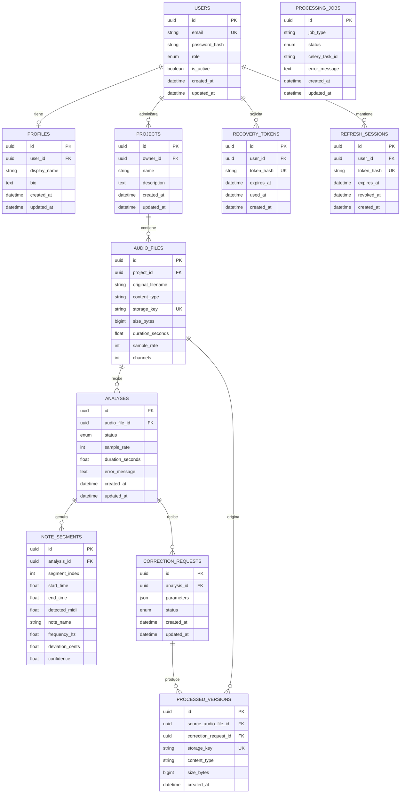

# Diagrama entidad-relación — Sprint 0

`PROCESSING_JOBS` es una entidad técnica preparada para enlazar tareas Celery con los servicios de análisis y corrección. En los siguientes sprints se completará la relación lógica con el recurso procesado.

